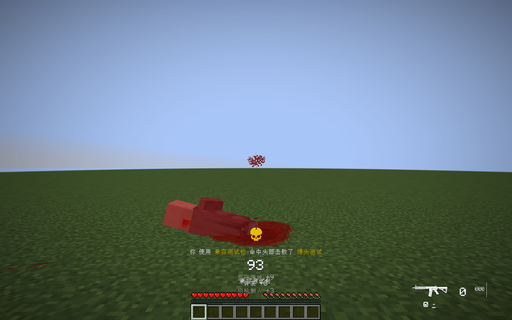
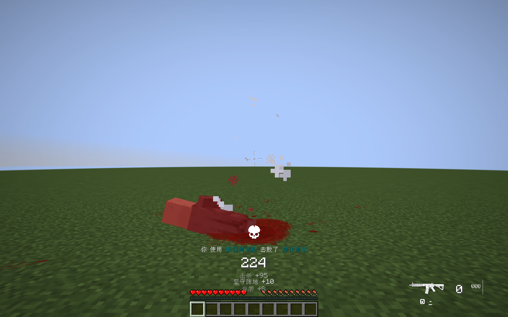

# 1.0.0 验证

原生客户端与集成服务器使用 Minecraft 1.21.1、NeoForge 21.1.251、GWO Beta1.0 Fix 0.5（内部 2.12.87）和 GD656Killicon 1.1.0.020。

NeoForge 21.1.233 与 21.1.251 的正式构建及 10 项单元测试均通过；最终安装包使用 21.1.251 构建。原生模组组合实测为 21.1.251。

## 自动与原生检查

- 10 项单元测试覆盖当前命中作用域、受害者匹配、连续命中、穿透目标切换与清理。
- 真实 GWO 子弹调用原判定并致死，GD656 的 PendingKill 分类为 2，经过原网络到客户端产生一个 headshot 图标；实际选择 headshot 纹理。
- 身体致死保持分类 0、default 纹理与单个图标，未制造重复击杀提示。
- 非致死爆头后身体击杀、穿甲弹、同一穿透子弹先头后身体分别分类均通过。
- 部位伤害组合中原 HEAD/BODY 伤害为 8/4；精确骨骼快照未被取消，非致死头击不会污染后续身体击杀。
- 19 米铁栅栏空隙的 HEAD/BODY 子弹实际飞行两个 tick 后命中，分别生成正确分类 2/0。

组合安装 Body Part Damage 1.0.2、GWO Precise Blocks 1.0.3、BetterBloodOverlay 2.2.0。原生摘要见 [runtime-validation.txt](runtime-validation.txt)，测试源码在 `src/smoke`，正式 JAR 不含烟测类。

## 验证边界

使用真实已连接玩家、实际伤害事件、原服务器队列与客户端渲染器；测试枪使用通过 GWO 公共 API 创建的配置，不依赖受保护枪械模型。烟测会清理 GWO 自有反馈音频队列，规避测试声音未注册导致的第三方异常，GD656 自有图标、音效和消息仍正常执行。测试专用代码不随安装包发布。

尚未实测真实双客户端并发或完整光影组合。兼容包只桥接 GWO 已给出的爆头结果；图标表现遵循 GD656 当前预设与既有显示开关。
